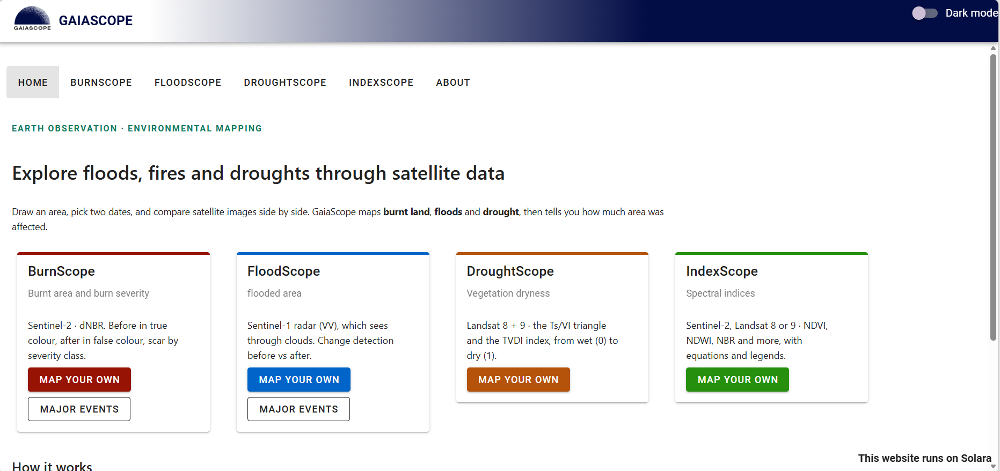
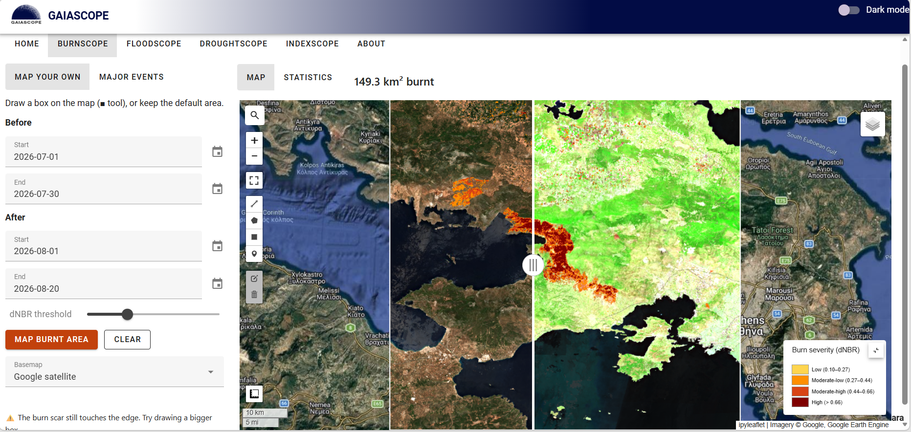
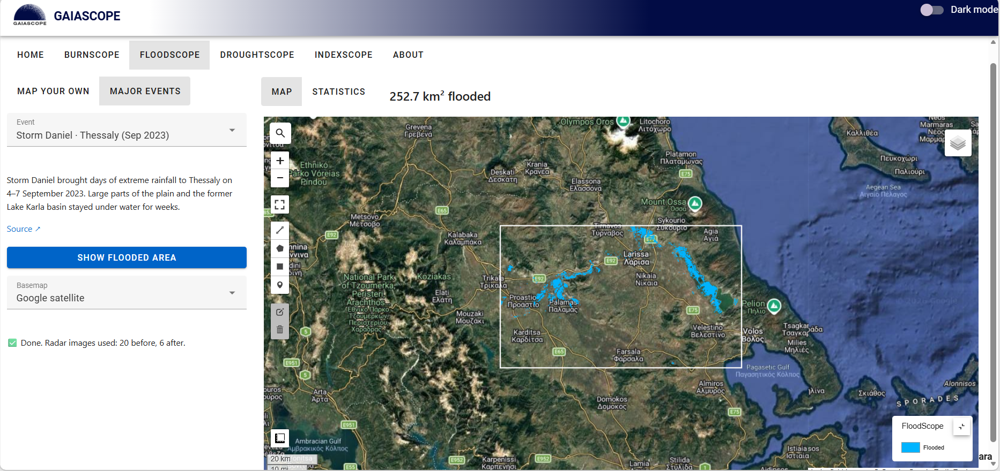
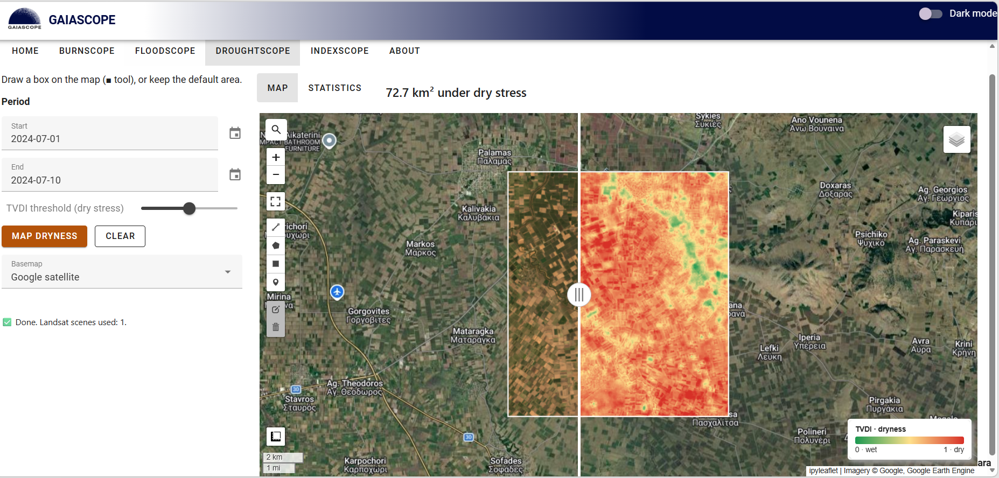
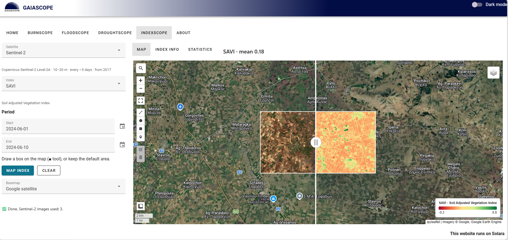

<p align="center">
  
</p>

<h1 align="center">GaiaScope</h1>

<p align="center">
  <b>Explore floods, fires and droughts through satellite data</b><br>
  A web application for mapping natural hazards with Google Earth Engine
</p>

---

GaiaScope turns free satellite data into maps and statistics of **wildfires, floods and drought**. Pick a documented Greek disaster from the list, or draw your own area anywhere in the world and choose the dates. GaiaScope finds the images, removes clouds, computes the indicator and reports how much land was affected and what kind of land it was.



## Modules

| Module | Question | Satellite data | Method |
| --- | --- | --- | --- |
| 🔥 **BurnScope** | How badly did a fire burn? | Sentinel-2 L2A | dNBR with USGS burn-severity classes |
| 🌊 **FloodScope** | Which land went under water? | Sentinel-1 SAR (VV) | Before/after backscatter change detection |
| ☀️ **DroughtScope** | How dry is the land surface? | Landsat 8/9 (optical + thermal) | TVDI from the Ts/VI triangle |
| 🌿 **IndexScope** | What does a spectral index show here? | Sentinel-2 or Landsat 8/9 | 14 indices (NDVI, EVI, SAVI, NDWI, MNDWI, NDMI, NDBI, BSI, NDSI …) |

Every module reports the affected area in km² and breaks it down by land cover (ESA WorldCover 2021), with tables and charts.

### Two ways to use each module

- **Mapped events:** ready-made wildfires and floods in Greece (2018–2026), each with dates, a short description and a link to the official Copernicus or ESA source.
- **Map your own:** draw a rectangle on the map, choose before/after dates and run the analysis. A swipe slider compares before and after.

| BurnScope | FloodScope |
| --- | --- |
|  |  |
| **DroughtScope** | **IndexScope** |
|  |  |

## Methods in brief

**BurnScope.** Sentinel-2 surface reflectance, clouds removed with the Scene Classification Layer. Normalised Burn Ratio NBR = (NIR − SWIR2) / (NIR + SWIR2); dNBR = NBR before − NBR after. Burnt land: dNBR > 0.27 (adjustable). Severity: moderate-low 0.27–0.44, moderate-high 0.44–0.66, high ≥ 0.66 (Key & Benson, 2006).

**FloodScope.** Sentinel-1 GRD, IW mode, VV polarisation, median composites smoothed with a 50 m focal median. A pixel is flooded when it is below −17 dB after the event and was not below −17 dB before; permanent water is excluded (after Twele et al., 2016). Radar sees through clouds, so floods can be mapped during storms.

**DroughtScope.** Landsat 8/9 Collection 2 Level 2, cloud and shadow masked. Land-surface temperature (Ts) is plotted against NDVI; the dry edge is fitted through the hottest pixels and the wet edge set by the coolest. TVDI = (Ts − Ts,min) / (Ts,max − Ts,min), from 0 (wet) to 1 (dry) (Carlson et al., 1994; Sandholt et al., 2002; Carlson, 2007; Petropoulos et al., 2009).

**IndexScope.** Each formula is written once with generic band names and mapped to Sentinel-2 or Landsat bands. Statistics are computed at 10 m (Sentinel-2, or 20 m when SWIR is used) or 30 m (Landsat). Formulas follow the Index DataBase (indexdatabase.de).

## Built with

Python · [Google Earth Engine](https://earthengine.google.com/) · [geemap](https://geemap.org/) · [ipyleaflet](https://ipyleaflet.readthedocs.io/) · [Solara](https://solara.dev/) · pandas · matplotlib

```
events.py    the ready-made disaster events (data only)
indices.py   spectral index formulas, colour ramps and references
engine.py    all Earth Engine processing (no interface code)
app.py       the web interface
```

## Run it yourself

You need Python 3.10+ and a Google Earth Engine account with a Cloud project ([sign up](https://earthengine.google.com/noncommercial/)).

```bash
git clone https://github.com/christinChris/gaiascope.git
cd gaiascope
python -m venv .venv
.venv\Scripts\activate            # Windows  (macOS/Linux: source .venv/bin/activate)
pip install -r requirements.txt
python -c "import ee; ee.Authenticate()"
```

Tell GaiaScope which Earth Engine project to use, then start it:

```bash
set EE_PROJECT=your-project-id    # Windows  (macOS/Linux: export EE_PROJECT=your-project-id)
solara run app.py
```

Open http://localhost:8765 in your browser.

## How to cite

If you use GaiaScope in your research, teaching or student work, please cite it:

> Lekka, C. (2026). *GaiaScope: a Google Earth Engine web application for disaster mapping and environmental monitoring from satellite data* (Version 1.0.0) [Software]. https://github.com/christinChris/gaiascope

You can also click **"Cite this repository"** on the right-hand side of this page.

## Licence

GaiaScope is free to use for **research, teaching and study**, under the [PolyForm Noncommercial License 1.0.0](LICENSE):

- ✅ Use, run, modify and share it for research, education and personal study.
- ✅ Universities, schools, public research bodies and non-profit organisations may use it freely.
- 📌 Keep the copyright notice and cite GaiaScope in work that uses it.
- ❌ Not for commercial use.

Copyright © 2026 Christina Lekka.

## Data and acknowledgements

Contains modified Copernicus Sentinel data (European Union / ESA). Landsat 8 and 9 data courtesy of the U.S. Geological Survey. Land cover: ESA WorldCover 2021 (© ESA WorldCover project, CC BY 4.0). Processing by Google Earth Engine. Event descriptions link to Copernicus Emergency Management Service, ESA and other public sources.

## References

- Carlson, T. N. (2007). An overview of the "triangle method" for estimating surface evapotranspiration and soil moisture from satellite imagery. *Sensors*, 7(8), 1612–1629.
- Carlson, T. N., Gillies, R. R., & Perry, E. M. (1994). A method to make use of thermal infrared temperature and NDVI measurements to infer surface soil water content and fractional vegetation cover. *Remote Sensing Reviews*, 9(1–2), 161–173.
- Key, C. H., & Benson, N. C. (2006). Landscape assessment (LA). In *FIREMON: Fire effects monitoring and inventory system* (Gen. Tech. Rep. RMRS-GTR-164-CD). USDA Forest Service.
- Petropoulos, G., Carlson, T. N., Wooster, M. J., & Islam, S. (2009). A review of Ts/VI remote sensing based methods for the retrieval of land surface energy fluxes and soil surface moisture. *Progress in Physical Geography*, 33(2), 224–250.
- Sandholt, I., Rasmussen, K., & Andersen, J. (2002). A simple interpretation of the surface temperature/vegetation index space for assessment of surface moisture status. *Remote Sensing of Environment*, 79(2–3), 213–224.
- Twele, A., Cao, W., Plank, S., & Martinis, S. (2016). Sentinel-1-based flood mapping: a fully automated processing chain. *International Journal of Remote Sensing*, 37(13), 2990–3004.
- Zanaga, D., et al. (2022). *ESA WorldCover 10 m 2021 v200*. Zenodo. https://doi.org/10.5281/zenodo.7254221

## Author

**Christina Lekka** — PhD candidate, Department of Geography, Harokopio University of Athens
